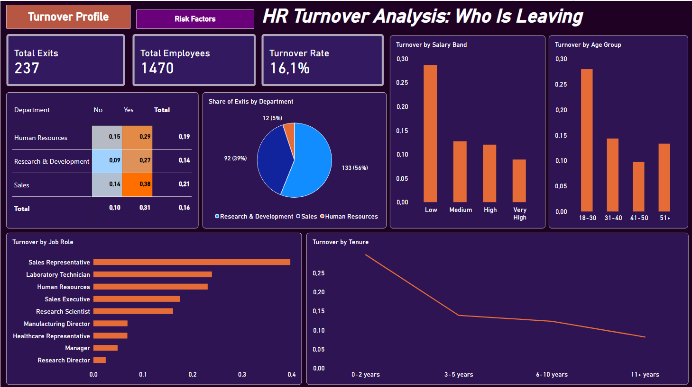
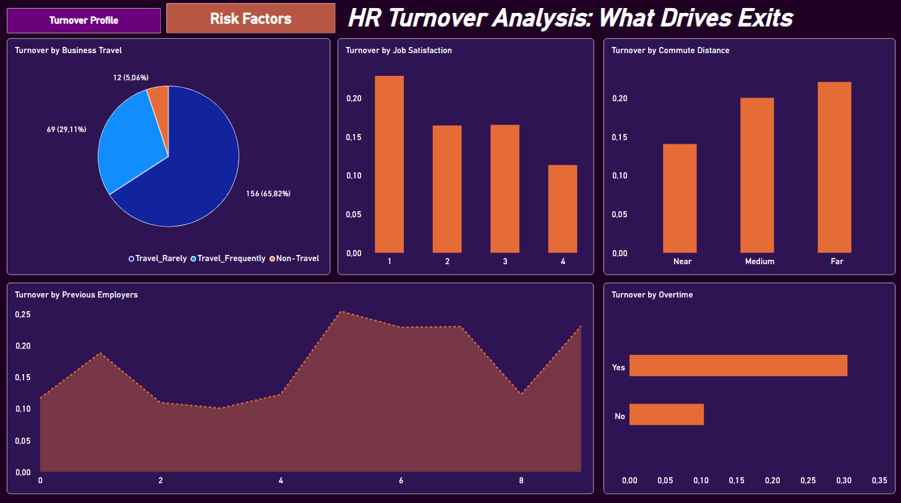

# HR Attrition Analysis

Análise de turnover (desligamento) de funcionários de uma empresa fictícia, com tratamento dos dados em Python, armazenamento em SQL Server e dashboard no Power BI. O projeto responde perguntas de negócio sobre quem sai da empresa e quais fatores estão associados às saídas, simulando uma análise real de retenção para apoio à área de RH.

## Fonte de Dados

Dataset público do Kaggle: [IBM HR Analytics Employee Attrition & Performance](https://www.kaggle.com/datasets/pavansubhasht/ibm-hr-analytics-attrition-dataset)

- 1.470 funcionários
- 35 colunas originais (idade, salário, departamento, cargo, tempo de empresa, satisfação, horas extras, entre outras)
- Coluna alvo: `Attrition` (Yes/No), indicando se o funcionário saiu da empresa

## Tecnologias

- Python (pandas, SQLAlchemy, pyodbc) no Jupyter Notebook
- SQL Server
- Power BI Desktop
- DAX

## Fluxo do Projeto

```
CSV (Kaggle)  →  Python (tratamento)  →  SQL Server (armazenamento)  →  Power BI (dashboard)
```

1. **Python:** limpeza, remoção de colunas sem informação e criação de colunas derivadas
2. **SQL Server:** carga da tabela tratada no banco `hr_analytics`
3. **Power BI:** conexão com o banco, criação das medidas em DAX e montagem do dashboard

## Tratamento dos Dados (Python)

O dataset já veio sem valores nulos. O tratamento consistiu em:

- Remover 3 colunas com valor único em todas as linhas (`EmployeeCount`, `StandardHours`, `Over18`)
- Criar faixas (`pd.cut`) para transformar variáveis numéricas em categorias legíveis
- Converter `Attrition` (Yes/No) em uma coluna binária (1/0) para facilitar o cálculo da taxa de turnover

```python
import pandas as pd

df = pd.read_csv('WA_Fn-UseC_-HR-Employee-Attrition.csv')

# Colunas com valor único em todas as linhas
df = df.drop(columns=['EmployeeCount', 'StandardHours', 'Over18'])

# Faixa etária
df['FaixaEtaria'] = pd.cut(
    df['Age'], bins=[18, 30, 40, 50, 100],
    labels=['18-30', '31-40', '41-50', '51+'], right=False
)

# Faixa salarial
df['FaixaSalarial'] = pd.cut(
    df['MonthlyIncome'], bins=[1000, 3001, 6001, 10001, 20000],
    labels=['Low', 'Medium', 'High', 'Very High'], right=False
)

# Faixa de distância de casa
df['FaixaDistancia'] = pd.cut(
    df['DistanceFromHome'], bins=[1, 11, 21, 30],
    labels=['Near', 'Medium', 'Far'], right=False
)

# Faixa de tempo de empresa
df['FaixaTempoEmpresa'] = pd.cut(
    df['YearsAtCompany'], bins=[0, 3, 6, 11, 100],
    labels=['0-2 years', '3-5 years', '6-10 years', '11+ years'], right=False
)

# Attrition em formato binário
df['AttritionBinario'] = df['Attrition'].map({'Yes': 1, 'No': 0})
```

## Carga no SQL Server

As colunas criadas com `pd.cut` são do tipo `category` no pandas, então foram convertidas para texto antes da carga.

```python
from sqlalchemy import create_engine

engine = create_engine(
    'mssql+pyodbc://SEU_SERVIDOR\\SUA_INSTANCIA/hr_analytics'
    '?driver=ODBC+Driver+17+for+SQL+Server&trusted_connection=yes'
)

for col in ['FaixaEtaria', 'FaixaSalarial', 'FaixaDistancia', 'FaixaTempoEmpresa']:
    df[col] = df[col].astype(str)

df.to_sql('funcionarios', con=engine, if_exists='replace', index=False)
```

O resultado é a tabela `funcionarios`, com 1.470 linhas. Como o dataset já tem uma linha por funcionário, sem repetição de informação, o modelo no Power BI usa uma única tabela (não há dimensões para separar, diferente de um modelo estrela).

## Medidas DAX

```dax
Total Employees = COUNTROWS(funcionarios)

Total Exits = SUM(funcionarios[AttritionBinario])

Turnover Rate = DIVIDE(SUM(funcionarios[AttritionBinario]), COUNTROWS(funcionarios))
```

Resultado geral: **237 saídas em 1.470 funcionários, uma taxa de turnover de 16,1%.**

## Perguntas Respondidas pelos Dados

### 1. Qual departamento tem maior taxa de turnover?

**Sales** lidera com cerca de 21%, seguido por Human Resources (19%) e Research & Development (14%). Em volume absoluto, porém, R&D concentra mais saídas (133 de 237), por ser o maior departamento.

### 2. Qual faixa salarial tem mais saídas?

A faixa **Low** tem turnover de cerca de 29%, mais que o dobro da faixa Medium (13%). As faixas High e Very High ficam em torno de 12% e 9%.

### 3. Funcionários com menos tempo de empresa saem mais?

Sim. O turnover é de cerca de **30% entre 0 e 2 anos** de empresa e cai de forma contínua: ~14% entre 3 e 5 anos, ~12% entre 6 e 10 anos e ~8% a partir de 11 anos.

### 4. Qual faixa etária tem maior turnover?

A faixa **18-30 anos** tem cerca de 28%, o dobro das demais (31-40: 14%, 41-50: 10%, 51+: 13%).

### 5. Horas extras influenciam na saída do funcionário?

Sim, e é o fator mais forte da análise. Quem faz hora extra tem turnover de cerca de **31%**, contra **10%** de quem não faz. O cruzamento por departamento mostra o pior caso: **Sales com hora extra chega a 38%**.

### 6. A distância de casa influencia no turnover?

Sim, de forma gradual: Near 14%, Medium 20% e Far 22%.

### 7. Funcionários que trabalharam em mais empresas saem mais?

De forma geral, sim, mas não linear. Quem passou por **5 ou mais empresas** tem turnover entre 23% e 25%, enquanto quem passou por 0, 2, 3 ou 4 fica entre 10% e 12%. Quem passou por 1 empresa fica em 19%. O valor de 8 empresas (~12%) foge do padrão, provavelmente por ser um grupo pequeno.

### Outros achados

- **Business Travel:** quem viaja com frequência tem turnover de ~25%, contra ~15% de quem viaja raramente e ~8% de quem não viaja.
- **Job Satisfaction:** a satisfação mais baixa (nota 1) tem cerca de 23% de turnover, contra cerca de 11% na nota mais alta (4).

## Dashboard

O dashboard tem duas páginas, com botões de navegação:

- **Turnover Profile:** mostra quem sai (por cargo, departamento, faixa salarial, faixa etária e tempo de empresa), com cartões de resumo e uma matriz de calor cruzando departamento e horas extras.
- **Risk Factors:** mostra possíveis fatores associados às saídas (viagens, satisfação, distância de casa, empresas anteriores e horas extras).





## Observações

- O dataset é fictício, criado por cientistas de dados da IBM, então os resultados servem para praticar a análise e não representam uma empresa real.
- As análises mostram **associação** entre fatores e turnover, não causalidade.
- Grupos com poucos funcionários (por exemplo, quem trabalhou em 8 ou 9 empresas) têm taxas mais instáveis e devem ser interpretados com cautela.
- As colunas derivadas foram criadas em português no banco (`FaixaEtaria`, `FaixaSalarial`, `FaixaDistancia`, `FaixaTempoEmpresa`) e renomeadas para inglês no Power BI.
